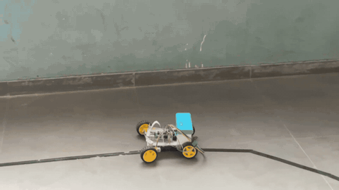
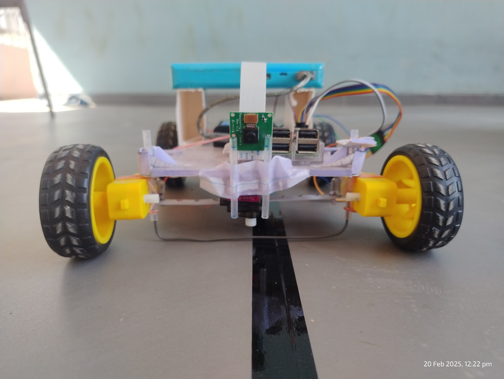
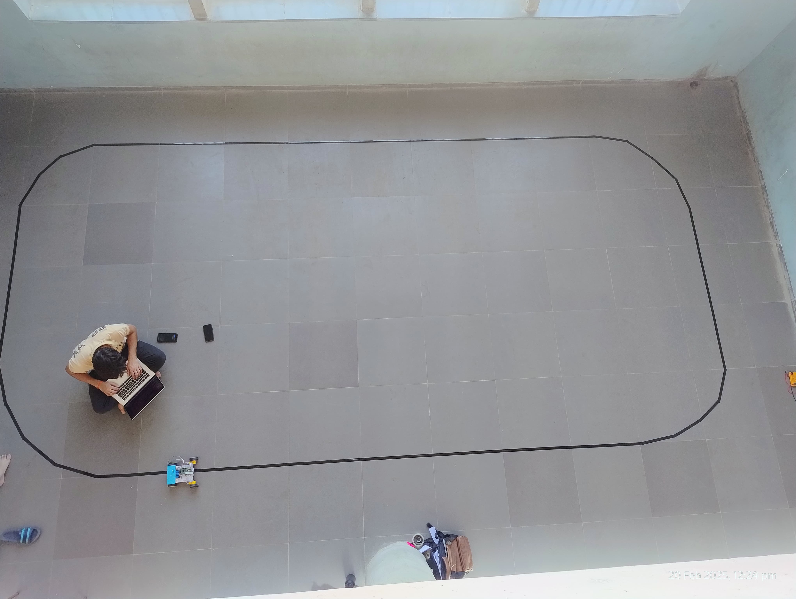

# Autonomous Model Car



A small self-driving RC car. A Raspberry Pi drives the car and streams camera frames over a WebSocket to a laptop. A PilotNet-style CNN on the laptop picks a steering angle and sends it back to the Pi. The car steers with Ackermann geometry, and a software differential adjusts the two drive speeds in turns.

Full video (38 s): https://github.com/user-attachments/assets/03713ffb-1726-465d-84f6-bb113e303b0e



## Pipeline

1. **Data collection** (`hotWheels.py`, runs on the Pi). Three worker processes communicate through shared memory (`multiprocessing.Value` holds the current speed and steering angle): one captures a camera frame roughly every 0.5 s and writes the angle into the filename, one drives the motors, and one reads the arrow keys. A parent process starts them and cleans up on exit.
2. **Dataset.** **3,700 training + 865 validation labeled frames.** Training frames are in `track3/road_data` and the validation frames are a separate collection in `track3/new_road_data/road_data`. The label is the angle in the filename minus 90, so it is an offset from straight ahead. The values fall into eight steering classes: -30, -20, -10, 0, 10, 20, 30 and 40 degrees. Straight dominates: in the April notebook, 1,538 of 3,720 frames were 0 degrees.
3. **Model.** A modified [PilotNet](https://developer.nvidia.com/blog/deep-learning-self-driving-cars/): five ELU convolutions (24, 36, 48, 64, 64 filters) and dense layers of 100, 50 and 10, on a 66 x 200 input. The server converts frames to YUV, applies a 3 x 3 Gaussian blur and scales to 0..1. The final models end in an 8-way softmax. Earlier single-output regression variants are kept too; see [Models](#models).
4. **Real-time inference over WebSocket** (`Laptopserver.py` and `pi/newWebsocket.py`). The Pi captures 640 x 480 frames, keeps the bottom 120 rows, JPEG-encodes and base64-encodes each frame, and sends it to the laptop's FastAPI `/ws` endpoint. The laptop preprocesses it, takes the argmax of the model output as one of the eight angles, and replies with `angle,speed`. The Pi adds 90 to turn that offset back into a servo angle, then sets the servo and the motor speeds. `Raspclient.py` is the earlier version of this client, kept for reference; it does not add the 90, so use `pi/newWebsocket.py`.
5. **On-Pi inference variant** (`pi/newmodelrun.py`). An experiment that runs the model on the Pi itself: capture, preprocessing and prediction run as separate processes that share frames through `multiprocessing.shared_memory`. The control process is commented out in the file, so as written it prints predictions without driving the car. It stores each prediction in a single shared float, so it needs a single-output (regression) model saved as `my_model.keras`. The `my_model.keras` inside `Models.zip` is an 8-class model, so it does not fit this script.

## Hardware

- Raspberry Pi 3 B+ and a Raspberry Pi Camera Module
- 9g metal gear servo for Ackermann steering, on GPIO 18
- DC motors on all four wheels, driven through an L298N motor driver (IN1 to IN4 on GPIO 23, 24, 27 and 22; enable pins on GPIO 25 and 17)
- Battery pack
- Laptop for inference

The Pi is driven with `pigpio` and `picamera2`. Motor speeds are scaled with the steering angle to mimic a differential.



## How to run

None of this has been re-run since the files were collected. Settings that differ per machine come from environment variables; copy `.env.example` to `.env`, fill it in, and load it in each shell with `set -a; source .env; set +a`.

**1. Collect data (Pi).**

```bash
sudo pigpiod
python3 hotWheels.py
```

Up and down arrows change speed; left and right change steering by 10 degrees between 40 and 140 (90 is straight). Frames land in `road_data/` as `img_<timestamp>_angle_<angle>.jpg`, and `steering_angles.csv` logs the same angles.

**2. Train (laptop).** Put the frames at `track3/road_data` and `track3/new_road_data/road_data` under the repo root, then open a notebook from there (see below); the notebooks read those relative paths.

**3. Drive.**

```bash
# laptop: needs tensorflow, keras, opencv-python, fastapi, uvicorn and keyboard
python Laptopserver.py        # serves ws://0.0.0.0:8000/ws, loads MODEL_PATH

# Pi: needs websockets, picamera2, opencv-python, pigpio and numpy
sudo pigpiod
SERVER_URI=ws://<laptop-ip>:8000/ws python3 pi/newWebsocket.py
```

`MODEL_PATH` defaults to `Models/new_kaggle_model3.keras`. On the laptop, the up and down arrow keys change the speed.

## Models

The final models are `Models/new_kaggle_model1.keras`, `new_kaggle_model2.keras`, `new_kaggle_model2_with_dropout.keras` and `new_kaggle_model3.keras`. All four end in `Dense(8, softmax)`, and `Laptopserver.py` loads `new_kaggle_model3.keras` by default. The other eight `.keras` files are earlier attempts: seven are single-output regression models (`Dense(1)` with linear or tanh activation) and `Models/my_model2.keras` is an 8-class model. The `.h5` files were not inspected. `converting_model.ipynb` converts a model to TFLite and loads `Models/my_model.keras`. That file exists only inside `Models.zip`: it is an 8-class model with dropout, saved on 2025-03-14, and the rest of the zip duplicates files already in `Models/`. `Models/model.h5` and `Models/model (1).h5` are byte-identical.

| Notebook | What it is |
|---|---|
| `Autonomous_car.ipynb` | First training run (March): 1,468 frames loaded, 1,204 used, 8-class softmax model |
| `Autonomous_car (1).ipynb` | April run on 3,720 frames, with class balancing to 3,032 |
| `Untitled copy.ipynb` | 8-class training on `track3/road_data`, with `track3/new_road_data/road_data` as the validation data |
| `Untitled.ipynb` | Regression variant, `Dense(1, tanh)` |
| `converting_model.ipynb` | Keras to TFLite conversion |

`For_RL/` holds two small scratch files (a vector plot and a Three.js view). They are not part of the pipeline.

## Limitations

- The collected frames are not included in this repo, so the notebooks cannot be re-run as they are.
- No accuracy or latency figures are recorded here.
- The on-Pi variant is unfinished, as described above.
